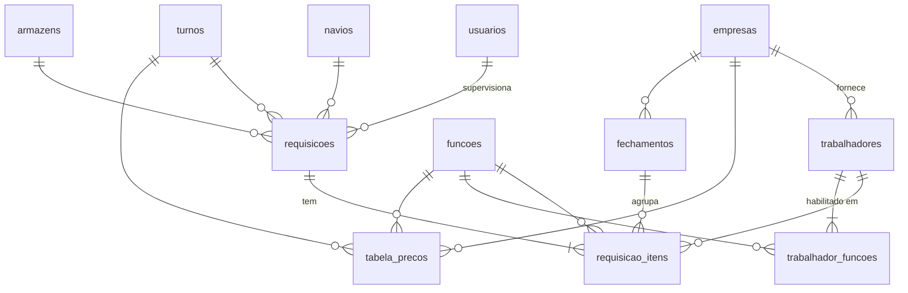

# Controle de Mão de Obra Seatrade — Requisições de Mão de Obra Portuária

Sistema web para supervisores informarem a mão de obra requisitada (por **navio**, **armazém**, **turno** e **trabalhador**) para o administrador aprovar e controlar custo, e para o financeiro fechar, conferir a NF e pagar cada empresa fornecedora.

- **Frontend:** um único `index.html` (sem build), publicado no **GitHub Pages**.
- **Banco e login:** **Supabase** (PostgreSQL + autenticação), plano gratuito.
- **Modo demonstração:** sem configurar nada, o site abre com dados fictícios salvos só no navegador.
- **Sigilo:** fornecedores e preços reais ficam **somente no Supabase**. Nenhum arquivo deste repositório contém nomes de fornecedores ou valores de contrato. A carga desses dados é feita por um arquivo privado (`privado/carga_dados.sql`), que nunca vai para o GitHub.

---

## 1. O que o sistema faz

| Perfil | Pode fazer |
|---|---|
| **Supervisor** | Criar requisição (navio, armazém, data, turno), adicionar/remover trabalhadores enquanto estiver *Aberta*, cancelar com motivo, duplicar para outro turno. Consulta navios (não cadastra). **Não vê valores.** |
| **Administrador** | Tudo do supervisor + aprovar/reabrir, cadastros (empresas, trabalhadores MEI, funções, turnos, armazéns, feriados), tabela de preços com vigência, usuários, painel de custos, auditoria, exportação CSV com valores, tudo do financeiro e estorno de pagamento. |
| **Financeiro** | Painel de custos, requisições com valores (consulta), **fechamentos por fornecedor**: gera o lote de diárias aprovadas, informa a NF, confere (diferença exige justificativa) e registra o pagamento. Cadastra navios. Consulta tabela de preços, empresas, trabalhadores (com chave PIX) e auditoria. **Não cria, não altera e não aprova requisições, e não altera preços.** |

### Regras garantidas pelo banco (não dependem da tela)

1. **Preço automático:** valor = tabela da empresa do trabalhador × função × turno × tipo de dia, na vigência da data. O supervisor nunca digita valor.
2. **Domingo/feriado automático:** pela data e pela tabela `feriados` (cadastre os municipais).
3. **Habilitação:** trabalhador só entra numa função em que está habilitado e se estiver ativo.
4. **Conflito de turno:** o mesmo trabalhador não pode estar em turnos sobrepostos no mesmo dia (ex.: 07x13 e 07x19).
5. **Fluxo:** supervisor só altera requisição própria e *Aberta*; só o administrador aprova. Navio novo só é cadastrado pelo administrador ou pelo financeiro.
12. **Número do espelho:** cada requisição recebe do banco um sequencial por ano (ex.: *2026/0001*), que não pula e não pode ser alterado.

**Espelho da requisição (PDF):** na tela da requisição, o botão *Espelho PDF* gera um PDF em folha carta na horizontal, leve (cerca de 50 KB), com o número, os dados, a lista de trabalhadores e um QR code que abre a requisição no sistema (só com login). Não mostra valores. No celular, o botão *Enviar (WhatsApp)* abre o compartilhamento direto; no computador, o PDF é baixado para anexar no WhatsApp como *Documento*.
6. **Sigilo de preço:** tabela de preços e valores só aparecem para administrador e financeiro (também na API).
7. **Auditoria:** inclusão/alteração/exclusão em requisições, itens, preços, trabalhadores, empresas e usuários fica registrada com usuário e antes/depois.
8. **Histórico de preço:** mudar um valor cria nova vigência; requisições antigas mantêm o valor da época.
9. **Fechamento só com aprovadas:** o fechamento inclui apenas diárias de requisições *Aprovadas*, da empresa e período escolhidos, que ainda não estejam em outro fechamento.
10. **Trava pós-fechamento:** requisição com diária em fechamento não pode ser reaberta, cancelada, mudar data/turno/navio/armazém nem perder trabalhador. Para corrigir, o financeiro desfaz o fechamento (só enquanto *Em conferência*).
11. **Conferência da NF:** só passa para *Conferido* com número e valor da NF; se a NF for diferente do sistema, a justificativa é obrigatória. *Pago* exige *Conferido* antes; estorno de pagamento só pelo administrador.

**Ciclo do fechamento:** `Em conferência` → `Conferido` → `Pago` (volta de *Conferido* para *Em conferência* é permitida; de *Pago* para trás, só o administrador).

**Dia operacional:** começa às 07h e termina às 07h do dia seguinte. O turno 01x07 pertence à data informada na requisição (ex.: 01x07 lançado no sábado é cobrado como sábado, mesmo ocorrendo na madrugada de domingo).

---

## 2. Estrutura do banco



| Tabela | Conteúdo |
|---|---|
| `usuarios` | Perfil (ADMIN/SUPERVISOR/FINANCEIRO) e liberação de acesso. Ligada ao login do Supabase. |
| `empresas` | Fornecedoras, CNPJ, contato, se fornece EPI e lanche. |
| `funcoes` | Operador de empilhadeira, conferente, auxiliar (editável). |
| `turnos` | 07x13, 13x19, 19x01, 01x07 (6h) e 07x19, 19x07 (12h), com hora de início e duração. |
| `armazens` | Locais de trabalho. |
| `navios` | Nome, viagem, ETA. |
| `feriados` | Datas cobradas como domingo/feriado (nacionais 2026–2027 já carregados). |
| `trabalhadores` | MEI: nome, CPF, CNPJ MEI, empresa, telefone, PIX. |
| `trabalhador_funcoes` | Funções em que cada trabalhador está habilitado. |
| `tabela_precos` | Valor da diária por empresa × função × turno × tipo de dia, com vigência. |
| `requisicoes` | Cabeçalho: data, turno, navio, armazém, supervisor, situação. |
| `requisicao_itens` | Um trabalhador por linha; empresa, horas e valor preenchidos pelo banco; `fechamento_id` quando entra num fechamento. |
| `fechamentos` | Lote por empresa × período: NF (número, data, valor), valor do sistema, justificativa, situação, conferência e pagamento. |
| `auditoria` | Log de alterações. |
| `vw_requisicoes`, `vw_itens`, `vw_fechamentos`, `vw_auditoria` | Visões para telas e relatórios (valores só para ADMIN e FINANCEIRO). |
| `gerar_fechamento()`, `desfazer_fechamento()` | Funções que criam e desfazem fechamentos (a tela chama via API). |

O arquivo `supabase/schema.sql` cria tudo isso e carrega só dados genéricos (funções, turnos, armazéns e feriados nacionais). Fornecedores e preços entram pelo arquivo privado de carga.

---

## 3. Instalação passo a passo

### 3.1 Supabase (banco + login)

1. Crie uma conta em <https://supabase.com> e um projeto novo (região *South America (São Paulo)*).
2. Menu **SQL Editor** → *New query* → cole todo o conteúdo de `supabase/schema.sql` → **Run**.
   - Em seguida, numa nova query, cole o arquivo privado `privado/carga_dados.sql` (fornecedores e preços) → **Run**. Ele fica só no seu computador.
3. Menu **Authentication → Sign In / Providers → Email**:
   - deixe **Allow new users to sign up** *ligado* (contas novas nascem bloqueadas; só funcionam depois que o administrador libera);
   - desligue **Confirm email** se não quiser que o usuário precise confirmar o e-mail antes do primeiro acesso.
4. **Authentication → Users → Add user → Create new user**: crie o seu usuário (e-mail e senha).
5. Volte ao **SQL Editor** e torne-se administrador:
   ```sql
   update public.usuarios set perfil = 'ADMIN', ativo = true, nome = 'Seu Nome'
    where email = 'seu.email@empresa.com.br';
   ```
6. **Project Settings → API Keys** (ou **Data API**): copie a **Project URL** e a chave pública — **Publishable key** (`sb_publishable_...`) ou, na aba *Legacy API keys*, a **anon public**. Nunca a *secret* / *service_role*.

### 3.2 Configurar o site

No `index.html`, logo no início do `<script>`:

```js
const CONFIG = {
  SUPABASE_URL: 'https://SEU-PROJETO.supabase.co',
  SUPABASE_ANON_KEY: 'sua-chave-anon-public'
};
```

A chave pública (*publishable* ou *anon public*) pode ficar no código público: quem protege os dados são as regras de segurança (RLS) do banco. **Nunca** coloque a chave *service_role* no site.

### 3.3 GitHub + GitHub Pages

1. Crie um repositório (ex.: `controle-mao-de-obra`). Pode ser **público**: os dados ficam no Supabase, não no repositório.
2. Envie **somente** estes arquivos, por **Add file → Upload files** no próprio GitHub:
   - `index.html`
   - `README.md`
   - `.gitignore`
   - a pasta `supabase` (com o `schema.sql`)

   **Nunca** envie a pasta `privado` (fornecedores, preços e resumo interno).
3. No repositório: **Settings → Pages → Source: Deploy from a branch → main / (root) → Save**.
4. Em 1–2 minutos o site estará em `https://SEU-USUARIO.github.io/controle-mao-de-obra/`.
5. No Supabase, **Authentication → URL Configuration → Site URL**: coloque esse endereço.

### 3.4 Primeiros cadastros (como administrador)

1. **Feriados**: inclua os feriados municipais de São Francisco do Sul.
2. **Empresas**: complete CNPJ e contatos.
3. **Trabalhadores**: cadastre os MEIs com empresa e funções.
4. **Navios** e **Armazéns**: ajuste aos seus.
5. **Usuários**: crie os supervisores e o financeiro (*Novo usuário* já libera o acesso).
6. **Tabela de preços**: confira os valores carregados com os contratos.

---

## 4. Fluxo de uso

```
Supervisor: Nova requisição → navio + armazém + data + turno → adiciona trabalhadores por função
Administrador: confere → Aprova (ou Reabre / Cancela)
Financeiro: Fechamentos → "A fechar" → Fechar (empresa + período) → informa NF → Conferir → Registrar pagamento
Resultado: Painel → "Custo por navio" → leva o custo de mão de obra para o resultado da escala
```

---

## 5. Dados sensíveis

- Fornecedores e preços reais ficam só no Supabase. Os pontos a conferir na tabela de preços estão no resumo interno (`privado/RESUMO.md`), fora do repositório.
- Fornecedor sem preço para uma função/turno fica bloqueado na escala (o banco recusa a inclusão).
- Os dados do modo demonstração (EMPRESA TESTE A…D, NAVIO TESTE 1…3) são fictícios.

---

## 6. Problemas comuns

| Sintoma | Causa / solução |
|---|---|
| Atualizando de uma versão anterior | Rode o `schema.sql` inteiro de novo: ele é reexecutável, cria só o que falta e mantém os dados. |
| "Seu acesso ainda não foi liberado" | Em *Usuários*, marque *Acesso liberado* (ou rode o `update` do item 3.1.5). |
| Novo usuário não consegue entrar | *Confirm email* ligado e o e-mail não foi confirmado. Confirme ou desligue a opção. |
| "Sem preço cadastrado…" ao adicionar | Falta preço para a empresa do trabalhador naquela função/turno/tipo de dia. Cadastre em *Tabela de preços*. |
| "permission denied" ao incluir trabalhador ou abrir uma tela | Rode o `schema.sql` inteiro de novo (ele refaz as permissões). **Não** libere `select` completo em `requisicao_itens`: isso exporia os valores aos supervisores. |
| Site abre em "Modo demonstração" | `SUPABASE_URL` / `SUPABASE_ANON_KEY` vazios no `index.html`. |

---

## 7. Próximas evoluções sugeridas

1. **Anexo da NF (PDF/XML)** no fechamento, usando o Storage do Supabase.
2. **Rateio por centro de resultado:** vincular navio à escala/centro de resultado usado no Sankhya e exportar no layout de importação.
3. **Assinatura do encarregado da empresa** na requisição (confirmação de presença).
4. **Importação de trabalhadores** por planilha.
